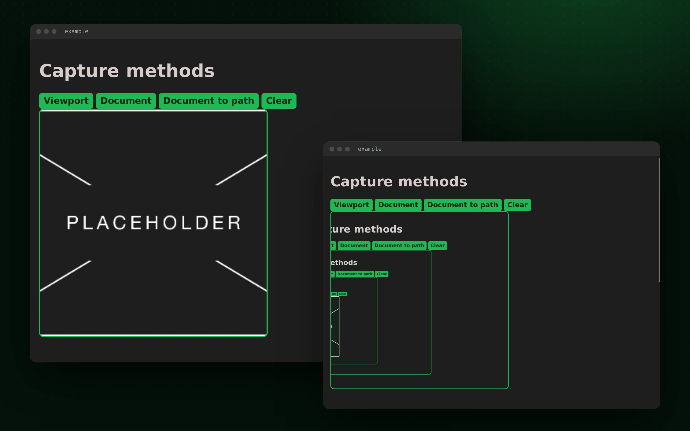

<p align="center">
  <a href="https://github.com/Fractal-Tess/tauri-plugin-snapshot/actions/workflows/test.yml"></a>
  
  <a href="LICENSE"></a>
</p>

<h1 align="center">tauri-plugin-snapshot</h1>

<p align="center">
  
</p>

<p align="center">
  A Tauri 1 plugin that captures the app's own webview as a PNG, from JavaScript or Rust.
</p>

Sometimes an app needs a picture of itself: a bug report attachment, a thumbnail of a document, an export. The webview engines can already do this, but each one exposes it differently. This plugin wraps WebKitGTK on Linux and WebView2 on Windows behind one command, `snapshot`, that returns PNG bytes and can also write them to disk. The whole API is two TypeScript functions and one Rust function.

- **Capture** the visible viewport or the whole document.
- **Save** the PNG to a path, with or without overwriting.
- **Keep** a transparent background or selection highlighting (Linux only).

> [!WARNING]
> Linux and Windows only. The macOS backend is a stub and will panic. On Windows the region and capture options are ignored and you always get the visible area. The plugin targets Tauri 1 and has not been ported to Tauri 2.

## Quick start

Register the plugin in `src-tauri/src/main.rs`:

```rust
fn main() {
    tauri::Builder::default()
        .plugin(tauri_plugin_snapshot::init())
        .run(tauri::generate_context!())
        .expect("error while running tauri application");
}
```

Then capture from the frontend:

```ts
import { snapshotViewport, snapshotDocument } from 'tauri-plugin-snapshot-api';

const png = await snapshotViewport(); // Uint8Array of PNG bytes

await snapshotDocument({
  save: { path: '/home/me/Pictures/page.png', overwrite: true },
});
```

Or from Rust, anywhere you have a `Window`:

```rust
use tauri_plugin_snapshot::{snapshot, Options, Region};

let png: Vec<u8> = snapshot(window, Options {
    region: Some(Region::Viewport),
    capture: None,
    save: None,
})?;
```

Dependency setup for Cargo and npm is in [INSTALL.md](INSTALL.md). The [example app](example/) is the one in the screenshot above.

## Documentation

- [INSTALL.md](INSTALL.md): adding the crate and the JS package, system libraries
- [CONTRIBUTING.md](CONTRIBUTING.md): repository layout, running the example, remaking the README image
- [CHANGELOG.md](CHANGELOG.md)

## License

[MIT](LICENSE) © Fractal-Tess and FabianLars
